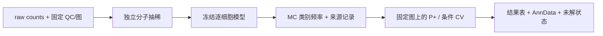

# 冻结逐细胞分类器：从 AnnData 原始计数到空间比较诊断

本教程完整演示一个固定线性分类器及自定义 `callable` 接入。输入是明确构造的合成计数和坐标，用于学习接口；模型系数没有在本数据上训练，`TYPE_A/TYPE_B` 不是经过验证的生物身份。

需要 Python 3.10+、NumPy、SciPy、pandas、AnnData 和 h5py，以及本目录对应的 `spatial_membership_audit` 源代码。示例从相邻 `src` 加载代码，不需要预先安装本包；不会下载模型、数据或安装依赖。若缺依赖，应在自己的环境中补齐后运行，不要让示例自动安装。包提供可选依赖组 `scverse` 供另行环境配置。

## 一次运行整份教程

可从任意工作目录运行，`--out-dir` 必须指向尚不存在的目录。下面是本工作区的 PowerShell 命令；重新运行时更换输出目录名：

```powershell
& 'C:\Users\13264\anaconda3\python.exe' -B -X utf8 'C:\Reproducution\software\spatial_membership_audit\examples\frozen_classifier_anndata.py' --out-dir 'C:\Reproducution\review\my_frozen_classifier_tutorial_run'
```

跨机器使用时，将解释器、脚本与输出目录改为自己的路径。完整源码是 [frozen_classifier_anndata.py](../examples/frozen_classifier_anndata.py)。下面各节是它的步骤与解释；可运行脚本包含导入、输入构造、保存读回及检查，不要求从零散片段补全程序。



## 1. 准备计数、固定 QC 和图

示例有6个节点、2个特征，计数为：

```python
counts = np.array([[4, 0], [0, 4], [2, 1],
                   [1, 2], [1, 1], [0, 0]], dtype=np.int64)
genes = ["GENE_A", "GENE_B"]
```

计数同时保存在 `adata.X` 和 `adata.layers['counts']`，实际审计明确指定 `count_layer='counts'`。`qc_pass` 在基线按总计数≥1确定，随后保持不变；不合格节点保留在同一图中，不通过删节点改变分母。

坐标也是合成示例，声明单位为 µm，以12 µm半径构建一次对称二值图，保存在 `adata.obsp['spatial_connectivities']`。后续所有保留率复用这一图。真实数据须根据导出元数据核对物理单位、区域和图的含义，不能从坐标数值猜测尺度。

## 2. 冻结模型及预处理

```python
model = FrozenLinearCentroidClassifier(
    genes=genes,
    classes=["TYPE_A", "TYPE_B"],
    weights=[[1.0, -1.0], [-1.0, 1.0]],
    intercept=[0.0, 0.0],
    scale_factor=1e4,
    min_margin=0.2,
    min_positive_markers=1,
)
model.weights.setflags(write=False)
model.intercept.setflags(write=False)
```

这个内置示例对**每个细胞自己的两个模型基因**做总计数归一化和 `log1p`，然后计算固定线性分数。正向分数、最低检出和分数差条件未满足时输出 `OTHER`。这不是原生 CellTypist、SingleR 或 InSituType 的复刻；换入已训练模型时必须保留该模型真实的特征顺序、归一化、缩放参数、分类与拒判规则。

参数、参考、拒判阈值和预处理都必须在抽稀前固定。不能在每次抽稀中重做聚类、用当前所有细胞重估中心/标准差、更新参考或做邻域投票。逐细胞总计数归一化满足本例要求；跨细胞统计量重估不满足。模型文件与参数应和结果共同保存；脚本输出 `frozen_model.json` 并核对本次执行前后模型未变化。哈希只用于版本绑定，不证明模型准确或参考合格。

## 3. 调用 AnnData 适配器

```python
result = audit_anndata(
    adata,
    classifier_fn=model,
    classes=["TYPE_A", "TYPE_B"],
    count_layer="counts",
    eligible_key="qc_pass",
    region_key="roi",
    coordinate_unit="um",
    p_grid=[1.0, 0.75, 0.5, 0.25, 0.0],
    classifier_draws=4096,
    seed=1729,
    cv_mode="direct",
    accuracy_factor=1.05,
    max_seconds=3.0,
    inplace=True,
    uns_key="frozen_classifier_scalar",
)
```

`p=1` 是原计数的确定性分类，`p=0` 是全零计数的确定性分类，两者记录 `n_draws=0`。中间保留率以4096次分子抽稀估计每个细胞的类别概率。`p_grid` 中第 i 个点实际使用 `seed + i*10007`，每行和provenance均记录该值。数值预算不足时保留未解；不为得到有限结果自动扩大预算。

内置模型按其定义处理。自定义模型遵循 `classifier_fn(counts_batch, genes) -> 每行一个互斥标签` 的协议，例如：

```python
def frozen_callback(counts_batch, genes):
    return model(counts_batch, genes)

custom = audit_anndata(
    adata, classifier_fn=frozen_callback,
    classifier_assume_cellwise=True,
    classes=["TYPE_A", "TYPE_B"],
    count_layer="counts", eligible_key="qc_pass", region_key="roi",
    p=0.5, classifier_draws=4096, seed=1729,
    cv_mode="direct", max_seconds=3.0,
)
```

脚本实际运行了这个自定义入口。`classifier_assume_cellwise=True` 是调用方对冻结、确定性、按细胞语义的确认；它不证明任意代码独立。有限的顺序/子集检查可以发现一些违规实现，不能证明全部输入上的独立性。脚本还实际演示了未确认的callable和依赖同批细胞均值的分类器被拒绝，错误信息保存为 `guard_examples.json`。未知或拒判标签保留节点，在目标类别之外的概率质量归入剩余类别，不把分类器分数或posterior直接当成抽稀标签概率。

## 4. 基因特异保留率

```python
vector_result = audit_anndata(
    adata, classifier_fn=model, classes=["TYPE_A", "TYPE_B"],
    count_layer="counts", eligible_key="qc_pass", region_key="roi",
    p=np.array([0.4, 0.8]),  # 与 adata.var_names 完全同序
    classifier_draws=4096, seed=1729,
    cv_mode="direct", max_seconds=3.0,
    inplace=True, uns_key="frozen_classifier_vector",
)
```

返回的 `p` 为包含全部值的 `vector:[...]`，对应基因顺序保存在provenance。它没有自动定义的标量深度顺序，因此 `retention_curve_status=NOT_EVALUATED_NONSCALAR_RETENTION`；不会为它套用标量非单调曲线判断。`p_grid` 只接受标量序列，多个向量方案应分别调用并保存各自provenance。

## 5. 读懂概率、区间和未解状态

| 字段 | 应如何解释 |
|---|---|
| `p_finite` | 两类可同时出现、比值可定义的概率；MC输入下是代入估计，另看 `p_finite_is_estimate` |
| `cv`, `cv_lower`, `cv_upper` | 给定输入概率的条件CV及数值包围，不是组织间生物学区间 |
| `semantics`, `n_draws`, `seed` | 概率随机对象、实际抽样次数及种子；不能用模型原始分数替代 |
| `conditional_cv_status`, `conditional_guarantee` | 图引擎对给定概率矩阵的计算状态与保证 |
| `guarantee=MC_PLUGIN_ONLY` | 使用MC估计概率，不能解读成端到端精确认证 |
| `upstream_probability_uncertainty`, `cv_interval_scope` | 下游数值包围不包含上游MC概率误差；本例没有完整误差传播认证 |
| `UNRESOLVED_UPSTREAM_SAMPLING` | 有限MC未确认支持状态，不能用抽样零断言事件不可能 |

脚本另外运行已知稀有事件：两细胞计数为 `[[20,0],[0,20]]`，p=.5，A要求第一基因全部20个保留，B要求第二基因至少一个保留。该合成模型的精确可用率为 `2^-20*(1-2^-20)>0`。512次抽样未抽到A时，输出应保持抽样未解，不能标成结构性缺失。观测到的MC零、原条件引擎状态与解析参考都保留。

`small_state_reference.json` 用两条有限枚举路径帮助理解边界：先枚举每细胞保留计数状态，再枚举小图标签状态。MC概率的最大差异按“6个二项SE+0.002”的工程容差检查，这不是覆盖率证明；D区间只要求包住**相同MC概率输入**对应的图参考，不能要求它自动覆盖“精确抽稀概率”对应的另一个目标值。

## 6. 保存、重新读取与交付文件

```python
adata.write_h5ad("audited.h5ad")
restored = ad.read_h5ad("audited.h5ad")
saved = restored.uns["frozen_classifier_scalar"]
table = saved["table"]
run = saved["provenance"]["probability_runs"]["retention_2"]
```

完整脚本实际保存并重新读取常规和稀有事件对象，核对draws/seed、误差说明、向量及基因顺序、未解状态、原始计数和固定图。`inplace=False` 时provenance在返回表的 `attrs` 中；CSV不会保存这些attrs，须同时保留AnnData或另存provenance。不同结果表合并时，pandas可能丢弃不同attrs，不能据合并表恢复全部模型来源。

| 产物 | 用途 |
|---|---|
| `frozen_model.json`, `input.h5ad` | 输入、QC/图与模型参数版本 |
| `scalar_audit.csv`, `vector_audit.csv`, `callback_audit.csv` | 三种实际入口结果；NA保留为NA |
| `per_cell_mc_probabilities.csv` | p=.5标量点实际使用的逐细胞类别概率 |
| `small_state_reference.json` | 小状态参考和条件数值区间核对 |
| `rare_event_audit.csv`, `rare_event_reference.json` | 稀有正概率与抽样未解例 |
| `audited.h5ad`, `rare_event.h5ad` | 可重新读取的完整结果与provenance |
| `guard_examples.json`, `summary.json`, `artifact_manifest.json` | 预期拒绝示例、实际检查与文件绑定 |

运行失败会保存 `failure.json` 和已完成的中间输出，不覆盖失败目录。成功只表示本例的软件链路与记录检查完成；不表示真实标签准确、物理稀释模型校准、患者层效用或所有第三方模型都已验收。迁移到真实模型前，首先核对原始整数计数、测得特征、冻结预处理、固定QC/图及逐细胞语义；需要重新拟合或联合平滑的模型应使用完整联合轨迹路线。
